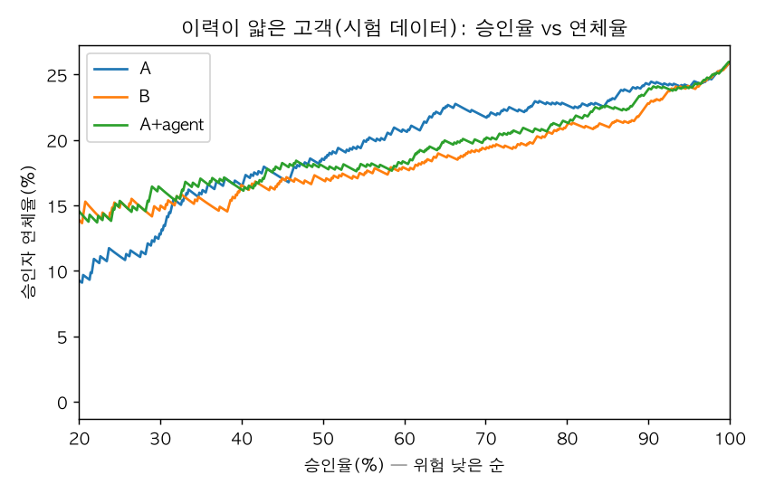

# thin-file-credit-agent

LLM 에이전트가 신용평가 피처를 제안하고, 코드가 검증해 채택 · 기각을 정하는 실험입니다. 대상은 이력이 얇은 카드 고객입니다. 에이전트는 가설과 SQL 만 내고, 라벨 · 보호 속성 · 시험 데이터 성적에는 손이 닿지 않게 만들었습니다. 사람이 만든 피처와 에이전트가 찾은 피처를 같은 규칙으로 비교했습니다.

설계는 [docs/DESIGN.md](docs/DESIGN.md), 에이전트의 제안 32개와 결정은 [reports/agent_log_from_b.md](reports/agent_log_from_b.md) · [reports/agent_log_from_a.md](reports/agent_log_from_a.md) 에 있습니다.

## 결과 요약

- **사람 피처 위에서는 에이전트가 더한 것이 없었습니다.** 제안 16개가 모두 채택 기준을 넘지 못했고, 가장 큰 개선은 얇은 이력 AUC +0.0018(기준 +0.002)이었습니다(실험 1).
- **사람 피처 없이 시작하면 에이전트 혼자 사람 개선분의 일부를 찾았습니다.** 16개 중 2개(4개 열)가 채택됐고, 시험 데이터 얇은 이력 AUC 는 A 0.640 → 에이전트 0.654 → 사람 0.675 입니다(실험 2).
- **이력이 얇은 고객 70% 승인 기준**, 승인자 연체율은 A 21.7%, 사람 피처 19.3%(-2.5%p, 95% 구간 -5.0 ~ -0.6%p), 에이전트 피처 20.0%(-1.7%p, 95% 구간 -4.2 ~ +0.2%p)입니다.

## 묻는 것

최근 이력이 얇은 고객은 지금 보이는 정보만으로는 점수가 잘 갈리지 않습니다. 이력에서 피처를 더 뽑으면 같은 연체율에서 더 많이 승인하거나, 같은 승인율에서 연체를 줄일 수 있나. 그리고 LLM 에이전트가 피처를 찾는 방식이 사람이 만든 피처와 비교해 어디까지 오나.

## 데이터

- UCI [Default of Credit Card Clients](https://archive.ics.uci.edu/dataset/350/default+of+credit+card+clients) (CC BY 4.0). 대만 신용카드 고객 30,000명의 2005년 4~9월 상환 상태 · 청구액 · 납부액, 라벨은 10월 연체(22.1%).
- **얇은 이력** = 6개월 중 청구가 있던 달이 3달 이하인 고객. 3,779명(12.6%), 연체율 23.6%. 모형 결과를 보기 전에 인원 비율만 보고 정했습니다.
- 개발 80% · 시험 20%(시험 데이터 6,000명 중 얇은 이력 756명, 연체 196명).
- 처음엔 Home Credit(Kaggle)을 쓰려 했지만, 대회 규칙이 데이터 사용을 대회 목적으로 제한해 공개 포트폴리오와 맞지 않아 바꿨습니다.

## 에이전트를 가두는 방법

| 겹 | 무엇을 막나 | 어디 |
|---|---|---|
| 데이터 분리 | 분석용 DuckDB 에는 `clients` · `monthly` 두 표만. 라벨 · 성별 · 혼인 · 나이는 다른 파일 | `src/data.py` |
| 문장 검사 | `json_serialize_sql` 로 SELECT 문 하나만 통과(SHOW 는 예외, 아래 「알려진 틈」), 구문 나무에서 표는 두 개만, 표 함수(read_csv 등) 금지 | `src/sandbox.py` |
| 연결 | 읽기 전용으로 열고 외부 접근(파일 · 네트워크)을 끈 뒤 설정 잠금. 문장 검사를 건너뛰어도 막힘 | `src/sandbox.py` |
| 시간 | 30초 넘으면 끊음 | `src/sandbox.py` |
| 출력 모양 | 고객 1명 1행, `f_` 로 시작하는 숫자 열 1~3개 | `src/features.py` |
| 누수 · 중복 | 피처 하나로 AUC 0.85 초과면 누수 의심, 기존 피처와 순위 상관 0.98 초과면 같은 정보 | `src/agent/evaluate.py` |
| 결정 | 채택 · 기각은 코드가. LLM 은 숫자를 정하지 않음 | `src/agent/evaluate.py` |
| 시험 데이터 | 마지막에 한 번만. `final.py` 는 두 번째 실행이 막히고, 시험 데이터를 여는 스크립트는 계산 전에 `reports/test_opened.json` 에 연 기록(커밋, 커밋 전 변경이면 -dirty)을 쌓음 | `src/final.py` · `src/supplement.py` |

새 눈 검토 때 손으로 넣어 본 공격 문장 가운데 59개는 `tests/test_attacks.py` 에 시험으로 고정했습니다. 파일을 표처럼 읽기 · 표 함수 · CTE 이름으로 가리기 · 시스템 표 · SELECT 가 아닌 문장 43개는 실행 전 문장 검사에서, 문장 검사를 건너뛰고 연결에 바로 넣은 설정 변경 · 쓰기 · 확장 설치 16개는 연결에서 막힙니다.

알려진 틈: `SHOW` 문(`SHOW ALL TABLES` 등)과 카탈로그를 붙인 이름(`analysis.main.clients`)은 문장 검사를 통과하고, 스칼라 함수는 검사하지 않습니다. 보이는 것은 메타데이터와 허용된 두 표뿐이고 라벨 · 파일에는 연결 겹 때문에 닿지 않아 그대로 두었습니다. 실제 서비스라면 문장 종류를 SELECT 로만 좁히고 함수 허용 목록을 두겠습니다.

LLM 은 이 PC 의 Claude Code CLI(`claude -p`)를 도구 없이(`--tools ""`), 빈 임시 폴더에서, 대화 기록을 남기지 않게 부릅니다.

## 채택 기준

개발 데이터에서 5겹 교차 검증을 3번 다르게 나눠(15쌍), 지금 피처 묶음 대비 얇은 이력 고객 AUC 가 오르는지 같은 겹끼리 비교합니다. 평균 +0.002 이상이고 15쌍 중 70% 이상에서 오르며, 전체 고객 AUC 가 -0.001 보다 나빠지지 않아야 채택합니다. 채택되면 다음 제안의 기준에 더해집니다.

## 실험과 결과

모두 같은 모형(scikit-learn 그래디언트 부스팅, 같은 설정)이고 피처 묶음만 다릅니다.

- **A 지금 한 장**(6개): 한도, 학력, 9월 상환 상태 · 청구액 · 납부액 · 한도 소진율
- **B 사람 피처**(17개): A + 6개월 집계 11개(연체한 달 수 · 최장 연체, 소진율 평균 · 최고, 청구 대비 납부 비율, 청구가 있는데 0원 낸 달 등)
- **실험 1 — B 위에서 시작한 에이전트**: 4라운드 × 4제안, **채택 0개**
- **실험 2 — A 만 보고 시작한 에이전트**: 같은 규칙, **채택 2개**. `f_status_trend` · `f_status_std`(상환 상태의 6개월 추세와 변동), `f_pay_cover_avg` · `f_underpay_cnt`(직전 청구 대비 납부 비율, 덜 낸 달 수)

### 시험 데이터 AUC · KS

| 묶음 | 피처 수 | AUC 전체 | AUC 얇은 이력 | KS 얇은 이력 |
|---|---|---|---|---|
| A | 6 | 0.768 | 0.640 | 0.215 |
| A + 에이전트 | 10 | 0.778 | 0.654 | 0.250 |
| B 사람 | 17 | 0.784 | 0.675 | 0.260 |

얇은 이력 고객은 전체보다 AUC 가 0.11~0.13 낮습니다. 이력이 얇은 고객을 가르기가 실제로 더 어렵다는 뜻입니다. A → B 의 얇은 이력 AUC 개선(+0.035) 가운데 에이전트 혼자 찾은 몫은 점 추정으로 약 40%(+0.014)입니다. 다만 아래 보조 지표에서 에이전트 - A 의 구간은 모두 0 을 포함해, 에이전트의 개선은 확실하다고 말할 수 없습니다.

### 같은 승인율에서의 연체율 (얇은 이력 756명, 부트스트랩 1,000번)

| 승인율 | A | A + 에이전트 | B 사람 | B - A (95% 구간) | 에이전트 - A (95% 구간) |
|---|---|---|---|---|---|
| 50% | 18.5% | 18.0% | 16.9% | -1.6%p (-4.3 ~ +0.9) | -0.5%p (-3.0 ~ +1.9) |
| 70% | 21.7% | 20.0% | 19.3% | **-2.5%p (-5.0 ~ -0.6)** | -1.7%p (-4.2 ~ +0.2) |
| 90% | 24.3% | 23.9% | 23.0% | **-1.3%p (-3.3 ~ -0.2)** | -0.3%p (-2.0 ~ +0.5) |



이 표는 시험 데이터를 연 뒤 덧붙인 보조 지표입니다(`reports/results_supplement.json`). 미리 정한 지표는 「A 가 x% 승인할 때의 연체율을 넘지 않는 최대 승인율」이었습니다. 그런데 얇은 이력 756명에서는 누적 연체율 곡선이 기준선 근처에서 출렁여 값이 크게 튀었습니다. 예를 들어 A → B 70% 기준은 +18.0%p 인데, 부트스트랩 95% 구간은 +0.3 ~ +20.0%p 로 점 추정이 구간 끝에 붙었습니다. 그래서 미리 정한 지표는 `reports/results.json` 에 그대로 두고, 보조 지표는 모형 · 피처를 바꾸지 않고 계산했습니다. 이 계산도 연 기록에 남겼습니다.

그래프를 보면 승인율 30% 안팎 아래의 가장 우량한 구간에서는 오히려 A 의 연체율이 낮습니다. 표본이 작아 단정할 수 없지만, 이력 피처가 「확실히 좋은 소수」를 고르는 데는 도움이 되지 않을 수 있다는 신호로 기록해 둡니다.

### 사후 공정성 (전체 시험 데이터, 80% 승인)

| | 남 승인율 · 승인자 연체율 | 여 | 29세 이하 | 30~44세 | 45세 이상 |
|---|---|---|---|---|---|
| B 사람 | 79.1% · 14.9% | 80.6% · 12.6% | 77.8% · 12.7% | 81.5% · 13.1% | 79.9% · 16.0% |
| A + 에이전트 | 78.4% · 14.8% | 81.1% · 13.0% | 78.0% · 13.3% | 81.6% · 13.2% | 79.4% · 15.8% |

승인율 차이는 성별 최대 2.7%p, 나이대 최대 3.7%p 입니다. 다만 같은 기준으로 승인된 남성 · 45세 이상의 연체율이 더 높아, 집단별 보정 점검이 필요합니다.

## 읽는 법

- 실험 1 에서 채택이 없었다고 에이전트가 쓸모없다는 뜻은 아닙니다. 한 번의 실행 · 16개 제안 범위에서는 사람 피처 위에 기준을 넘는 개선이 없었고, 6개월짜리 짧은 이력에 남은 정보가 적을 가능성이 큽니다(단정은 못 함). 사람 피처가 없을 때는 에이전트가 같은 방향의 신호(연체 추세, 청구 대비 납부)를 스스로 찾았습니다.
- 에이전트가 찾은 4개 열이 사람 피처와 얼마나 겹치는지 개발 데이터만으로 쟀습니다(`src/overlap.py` → `reports/overlap.json`, 라벨 안 씀). 얇은 이력 고객에서 `f_underpay_cnt` 는 사람의 납부 비율과 순위 상관 -0.97, `f_status_std` 는 최장 연체와 0.84, `f_pay_cover_avg` 는 납부 비율과 0.86 입니다. 사람 피처 11개로 설명되는 비율(R²)은 0.75~0.96 입니다. 사람 피처와 덜 겹치는 것은 `f_status_trend`(최근 3달과 이전 3달의 상환 상태 차이) 하나로, 가장 큰 상관이 0.45 · R² 0.65 입니다. 에이전트는 대부분 사람이 이미 만든 피처를 다시 찾았고, 실험 1 에서 채택이 없었던 것과 맞는 결과입니다.
- 채택 기준이 엄격해서 +0.0018 같은 작은 개선은 버려졌습니다. 기준은 결과를 본 뒤에 바꾸지 않았습니다. 작은 개선을 많이 받아들이면 개발 데이터에 맞추게 되고, 시험 데이터에서 사라지기 쉽기 때문입니다.
- 실제 데이터가 훨씬 길고 넓다면(거래 · 앱 이용 · 결제처) 에이전트가 찾을 공간도 커집니다. 이 실험은 그 방식을 안전하게 돌리는 틀을 보여 주는 데 무게가 있습니다.

## 한계

- 한 시점 데이터라 다른 시기 검증(OOT)을 못 했고, 승인된 카드 고객만 있어 거절자 결과 추정(reject inference)도 못 했습니다.
- 비금융 대안 데이터가 없어, 질문은 「대안 데이터」가 아니라 「얇은 이력을 얼마나 더 잘 읽나」입니다.
- 얇은 이력 시험 표본이 756명(연체 196명)이라 구간이 넓습니다.
- 에이전트 실행은 한 번씩입니다. LLM 답은 실행마다 달라 같은 결과가 다시 나온다는 보장은 없습니다(제안과 SQL 은 모두 기록에 있음).
- 분석 DB 에는 시험 고객의 피처 행(라벨 없음)도 들어 있어, 에이전트 SQL 이 고객을 가로지르는 값(전체 순위 · 평균)을 만들면 시험 고객의 피처 분포가 섞일 수 있습니다. 이번에 채택된 SQL 두 개는 고객별 집계라 해당하지 않습니다.
- 2005년 대만 데이터라 지금 고객에 그대로 맞지 않습니다.

## 실행

```bash
uv sync
# data/raw/ 에 UCI 원본 「default of credit card clients.xls」를 둔 뒤
uv run python src/data.py                                 # 분석 DB · 라벨 · 보호 속성 · 나누기
uv run python -m unittest discover -s tests               # 시험 17개(공격 문장 59개 포함)
uv run python src/agent/loop.py --base b                  # 실험 1 (Claude Code CLI 필요)
uv run python src/agent/loop.py --base a                  # 실험 2
uv run python src/report_agent.py                         # 기록 → reports/agent_log_*.md
uv run python src/final.py                                # 시험 데이터 한 번 열기
uv run python src/supplement.py                           # 보조 지표
uv run python src/overlap.py                              # 에이전트 피처와 사람 피처의 겹침(개발 데이터만)
```

## 만든 방식

Claude Code 로 구현했습니다. 에이전트 루프 안의 LLM 도 Claude(Claude Code CLI)입니다.
